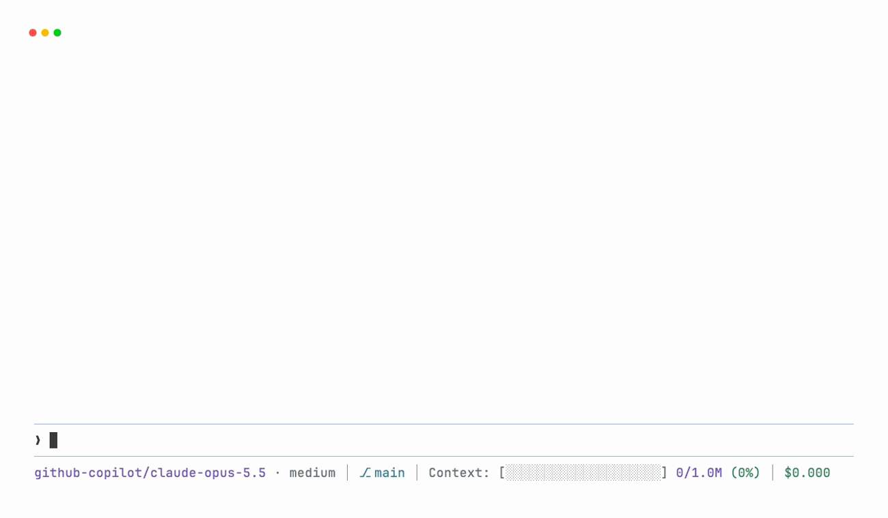

# pi-custom-agents

A minimal way to write your own subagents for [Pi](https://pi.dev). An agent is a markdown file with a prompt and, if you like, a model. `/agent <name>` starts it in the background while you keep working, and you can click it to follow what it's doing. Agents only run when you start them: Pi doesn't spin them up on its own.

<picture>
  <source media="(prefers-color-scheme: dark)" srcset="https://raw.githubusercontent.com/Pringled/pi-extensions/main/assets/images/pi-custom-agents-dark.gif">
  
</picture>

```bash
pi install npm:pi-custom-agents
```

## Usage

An agent is a markdown file in `~/.pi/agent/agents/`. The file name is the agent's name, the body is its prompt, and the frontmatter can set a description and model:

```markdown
---
description: Review this branch before merging
model: openai/gpt-5
---
Review this branch against main for bugs. $ARGUMENTS
```

- `/agent review` runs it in the background while you keep working. `/agent review focus on the auth code` puts the rest where the prompt says `$ARGUMENTS`, or after the prompt when it doesn't.
- `/agent <prompt>` runs any other prompt the same way, with the model you're on.
- `/agent` on its own lists your agents.

By default, an agent starts without any context. For an agent that should have the conversation's context, add `context: fork` to its frontmatter:

```markdown
---
description: Try the other approach we discussed
context: fork
---
Try the other approach we discussed and tell me how it compares. $ARGUMENTS
```

Each running agent gets a line above the input; click it to see what the agent is doing, and click its title or press esc to close that again. Its report lands in the chat when it's done. Every agent's session is saved, so you can open it with `pi --session <id>` (the report says which) and carry on where it stopped.

Prompt templates can hand work to agents too. In a run started by a command or prompt template, Pi gets an `agent` tool, so a template can say "use the agent tool with openai/gpt-5 to look for bugs, and another one with anthropic/claude-opus for code that could be simpler, then combine their reports". It waits for their reports instead of running them in the background, so a template can stop in between to ask you something.

## License

MIT
