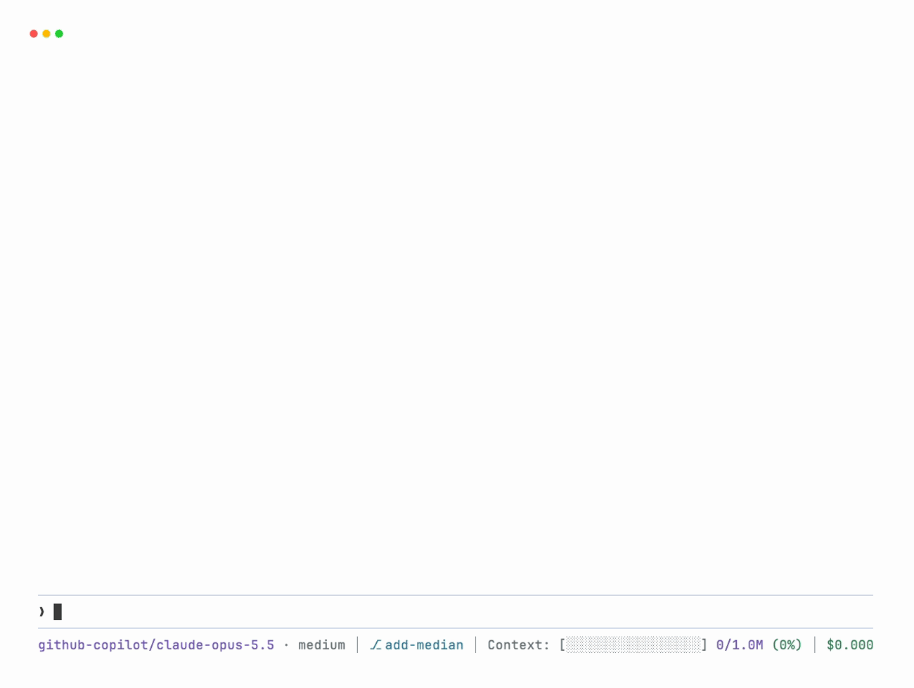
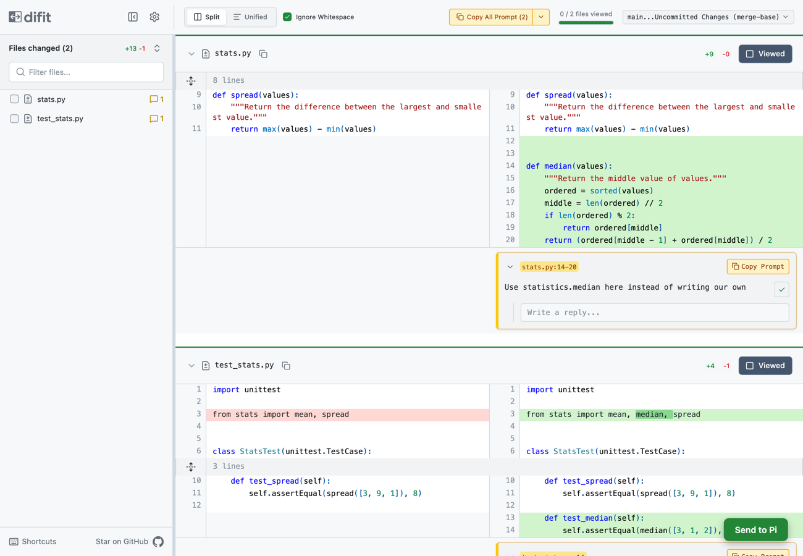

# pi-feedback

Give [Pi](https://pi.dev) feedback on its changes: look through them in a GitHub-style view in your browser, leave comments on lines, and send them all back to Pi in one go.

<picture>
  <source media="(prefers-color-scheme: dark)" srcset="https://raw.githubusercontent.com/Pringled/pi-extensions/main/assets/images/pi-feedback-dark.gif">
  
</picture>

```bash
pi install npm:pi-feedback
```

This also installs [difit](https://github.com/yoshiko-pg/difit), which draws the review page in your browser (about 235 MB with its own dependencies).

## Usage

Run `/feedback`. Your browser opens with everything on the current branch since it left `main`, including uncommitted changes and new files. Click a line, or drag over several, to comment:

<picture>
  <source media="(prefers-color-scheme: dark)" srcset="https://raw.githubusercontent.com/Pringled/pi-extensions/main/assets/images/pi-feedback-browser-dark.png">
  
</picture>

Press **Send to Pi** in the bottom-right corner. Your comments go to Pi as one message:

```
Here's my feedback on the changes against main:

stats.py:L14-L20
Use statistics.median here instead of writing our own

test_stats.py:L14
Also test an even number of values
```

If Pi is busy, the message waits until it's done. If you didn't leave any comments, nothing is sent.

The tab then shows only what Pi changes from there, and updates as Pi works: comment on that and send again, as many rounds as you like. Press **Done**, or run `/feedback` again in Pi, to finish; comments you haven't sent yet go to Pi then. Closing or reloading the tab doesn't end the review.

- `/feedback since` opens a new review of what changed after you last sent feedback. When you send, pi-feedback saves the files as they were, in a ref under `refs/pi-feedback/` that isn't a branch and isn't pushed; untracked files over 1 MB are left out.
- `/feedback dev` compares with another branch instead of the default one.
- On `main` itself, `/feedback` shows your uncommitted changes.
- If the browser didn't open, for example because Pi runs in a sandbox, the address is shown above Pi's input.

## License

MIT
