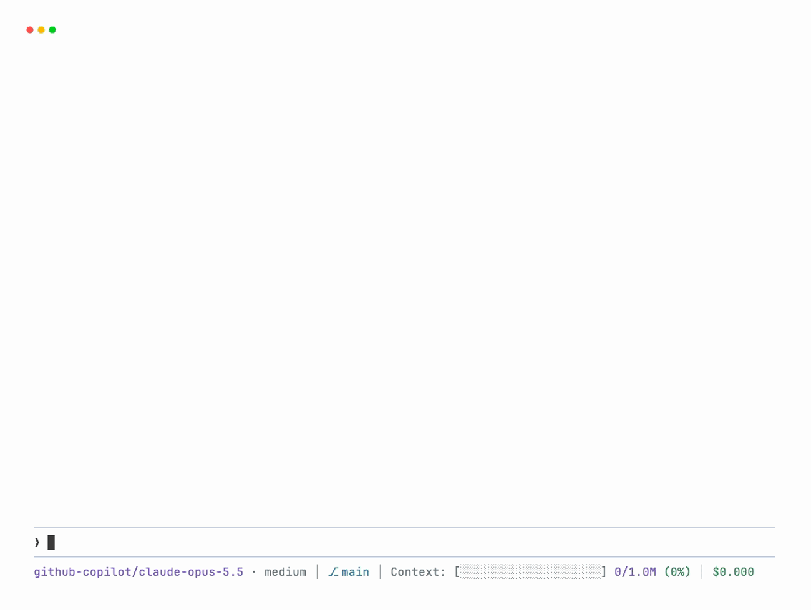

# pi-polish

Makes [Pi](https://pi.dev)'s output look like Claude Code's: tool calls fold into short summary lines, and edits show as colored diffs.

<picture>
  <source media="(prefers-color-scheme: dark)" srcset="https://raw.githubusercontent.com/Pringled/pi-extensions/main/assets/images/pi-polish-dark.gif">
  
</picture>

```bash
pi install npm:pi-polish
```

## Features

- Shell commands, file reads, searches and MCP calls in a row fold into one line, such as `Ran 3 shell commands, read 2 files`. Click a row (or press `ctrl+o` for all of them) to see each command and its output.
- Edits and new files show as diffs with syntax highlighting, in your Pi theme's colors.
- A dot shows each tool's state: pulsing while it runs, grey when done, red when it failed, green for edits.
- An orange status line shows what Pi is doing, the time and the tokens so far, and a dim line says how long it worked when it's done.
- `❯` marks your messages and `●` marks Pi's replies.
- Pi is asked to change files with its edit and write tools rather than `sed -i`, so changes show as diffs.

## Compatibility

The chat styling (the markers and the status line) uses Pi's internal UI, so a new Pi release can break that part until pi-polish is updated. Tested with Pi 1.4.

## License

MIT
